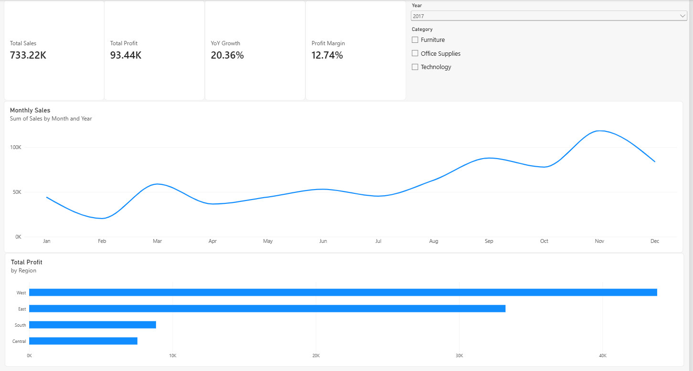
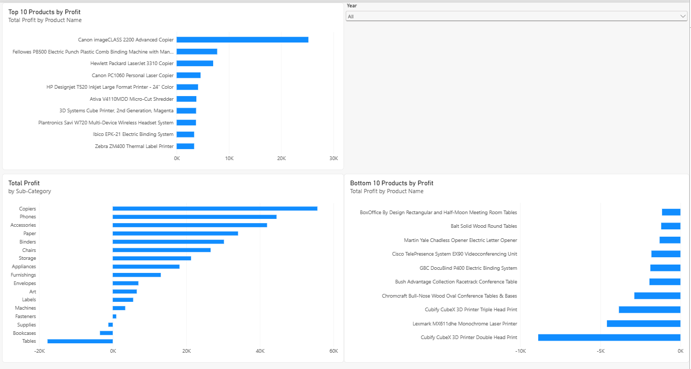
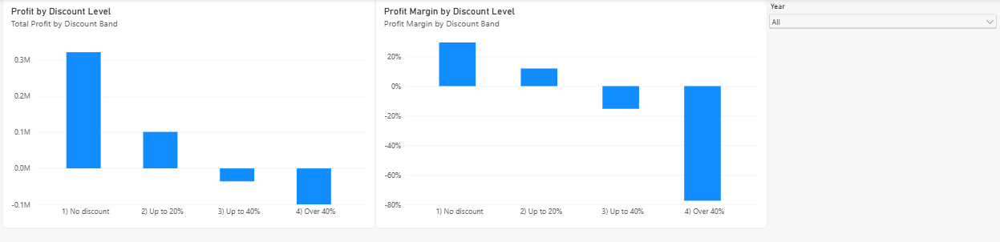

# Sales Performance Dashboard
Power BI sales performance analysis using the Superstore dataset

## Business questions
- Which products and regions make the most profit?
- Which ones lose money?
- How do discounts affect profit?
- How are sales changing year over year?

## Data
Superstore dataset (Kaggle: https://www.kaggle.com/datasets/vivek468/superstore-dataset-final, 16 Oct 2026, 9,994 rows).

## Approach
Tools: Power BI (DAX), SQL and Python (DuckDB in Google Colab)
Notebook: [notebooks/discount_analysis.ipynb](notebooks/discount_analysis.ipynb)

Cleaning steps: Promoted headers, checked data types, checked blanks and errors (none found), removed 1 fully duplicated row (9,994 to 9,993 rows), renamed table to Orders.

## Key findings
- Orders with no discount earn a profit margin of roughly 30%, while orders with discounts over 40% lose roughly 77% of sales value.
- Profit turns negative once discounts exceed 20%.
- Copiers and Accessories are the top profit sub-categories. Tables lose the most (about -18K), and the Cubify CubeX 3D Printer is the single biggest loss-making product.
- 2017 sales grew 20.4% over 2016, and the West region earns the most profit.
- Note: discounted orders may include different products from full-price ones, so the discount results show a strong link to losses but do not prove that discounts alone cause them.
- Confirmed in SQL: no-discount margin 29.5%, over-40% discount margin -77.4%.
  
## Dashboard
**Overview (2017):**

**Products (all years):**

**Discount (all years):**

## What I would do next
- Add a sales forecast for the next 6 months.
- Break down the discount analysis by category, to check whether the losses come from discounts or from the products themselves.
- Compare discount impact by region
